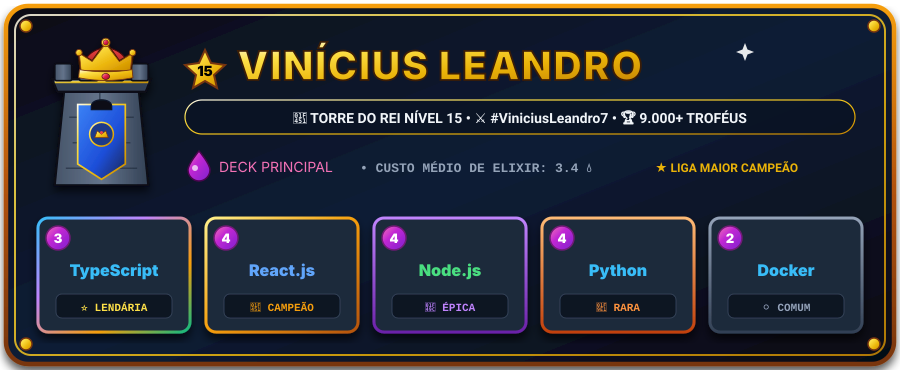
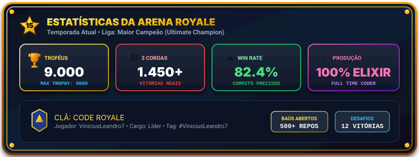

  <!-- =================================================== -->
  <!-- BANNER RESPONSIVO E ADAPTÁVEL (TEMA CLARO & ESCURO) -->
  <!-- =================================================== -->
  <picture>
    <source media="(prefers-color-scheme: dark)" srcset="assets/header.svg">
    <source media="(prefers-color-scheme: light)" srcset="assets/header-light.svg">
    
  </picture>

    

  <!-- Badges de Status do Jogador Royale (Alto Contraste Claro/Escuro) -->
  

    
    
    
    
  

### 🏰 Perfil da Torre do Rei & Bio de Batalha

> *"HEE-HEE-HEE-HAW! Bem-vindo à minha Arena no GitHub."*

- 👑 **Nível da Torre:** Nível 15 (Torre de Elite / Rei Protegido).
- ⚔️ **Estratégia:** Desenvolver aplicações completas, do Front-end ao Back-end, focando em escalabilidade, código limpo e arquitetura robusta.
- 💧 **Produção de Elixir:** Café ☕ + TypeScript + Docker + Deploys contínuos.
- 🎯 **Missão Atual:** Vencer batalhas diárias contra bugs e construir aplicações que alcançam o topo do ranking mundial!

---

### ⚔️ Deck de Batalha (Tecnologias & Habilidades)

As tecnologias que compõem meu deck de batalha, organizadas por raridade de carta:

#### 👑 **Cartas Campeãs** *(Habilidades Principais)*

  
  
  

#### 🌟 **Cartas Lendárias** *(Back-end & Arquitetura)*

  
  
  
  

#### 💜 **Cartas Épicas** *(Frameworks & Estilos)*

  
  
  
  

#### 🧡 **Cartas Raras & Comuns** *(Ferramentas & Suporte)*

  
  
  
  

---

### 📦 Ciclo de Baús (Projetos em Destaque)

| Baú | Projeto | Missão & Tecnologias | Recompensa / Status |
|:---:|:---|:---|:---:|
| 👑 | **Sistema Full Stack Royale** | Aplicação completa com Auth, Pagamentos e Dashboard | ⭐️⭐️⭐️ Concluído |
| 💎 | **Microserviços & APIs** | API escalável desenvolvida em Node/TypeScript com Docker | ⚡ Em Batalha |
| ⚡ | **Design System & UI** | Componentes modernos e responsivos em Tailwind e Next.js | 🔓 Desbloqueado |

---

### 📊 Estatísticas da Arena (Royale Battle Stats)

<!-- Card Adaptável Automaticamente: Tema Noturno no Modo Escuro e Mármore Real no Modo Claro -->

  <picture>
    <source media="(prefers-color-scheme: dark)" srcset="assets/stats.svg">
    <source media="(prefers-color-scheme: light)" srcset="assets/stats-light.svg">
    
  </picture>

 

  
<b>⚙️ Deseja ativar estatísticas dinâmicas do GitHub? (Clique aqui)</b>

   
  
  > [!TIP]
  > Para que os cards abaixo carreguem os seus dados reais do GitHub sem erro de *"Could not find a user with that name"*, substitua a palavra `seu-usuario-github` pelo seu usuário verdadeiro do GitHub.

  

    <!-- Card Geral Responsivo com suporte a claro/escuro -->
    <picture>
      <source media="(prefers-color-scheme: dark)" srcset="https://github-readme-stats.vercel.app/api?username=seu-usuario-github&show_icons=true&bg_color=090f1d&border_color=eab308&title_color=facc15&text_color=cbd5e1&icon_color=f472b6">
      <source media="(prefers-color-scheme: light)" srcset="https://github-readme-stats.vercel.app/api?username=seu-usuario-github&show_icons=true&bg_color=ffffff&border_color=b45309&title_color=92400e&text_color=0f172a&icon_color=be185d">
      
    </picture>
  

  

    <!-- Streak Stats Responsivo -->
    
  

### 💬 Mandar Emote & Contato

  
  &nbsp;&nbsp;
  
  &nbsp;&nbsp;
  

 

  👑 *"Boa sorte na arena e nos vemos no topo do placar!"* 🏆

